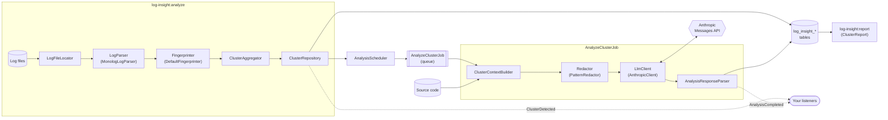

# Laravel Log Insight

[](https://github.com/markdoel/laravel-log-insight/actions/workflows/tests.yml)
[](https://github.com/markdoel/laravel-log-insight/actions/workflows/static-analysis.yml)
[](LICENSE.md)

Laravel Log Insight reads your Laravel logs, groups recurring errors into clusters and asks an AI model for the root cause and a fix, one request per cluster.

Instead of scrolling through thousands of log lines, you get a short list: *this* error happened 40 times since yesterday, it starts in `OrderController.php:42`, and this is most likely why.

## Features

- **Log parsing:** reads Laravel's default Monolog format, from both `single` and `daily` log files. Multi-line messages, stack traces and previous exceptions are merged into one entry. Files are streamed, so large logs are fine.
- **Clustering:** each error gets a fingerprint made of the exception class, the normalized message and the topmost application frame. IDs, UUIDs, e-mail and IP addresses, timestamps, URLs and variable path segments are normalized away, so the same bug lands in the same cluster. Each cluster tracks its count and its first and last occurrence.
- **Idempotent runs:** analyzing the same log twice never counts an entry twice.
- **Privacy first:** a redaction layer removes secrets, tokens, passwords, credentials, e-mail and IP addresses before anything leaves your server. You can add your own patterns.
- **AI analysis:** one queued job per new cluster calls the Anthropic Messages API through Laravel's HTTP client, with no SDK. The context is the representative stack trace plus the source code around the affected line. The answer is structured JSON: `root_cause`, `suggested_fix`, `affected_files`, `severity`, `confidence`.
- **Cost control:**
  - A cluster that already has an analysis is never sent again.
  - Invalid answers get exactly one correction request.
  - Permanent failures are recorded and not retried.
- **Events:** `ClusterDetected` and `AnalysisCompleted`, so you can attach notifications or ticket creation.
- **Reports:** a terminal table, or JSON for scripts and CI.
- **Extensible:** `LogParser`, `Fingerprinter`, `Redactor` and `LlmClient` are interfaces bound in the container.

## Requirements

- PHP 8.2 or higher
- Laravel 12 or 13 (Laravel 13 needs PHP 8.3+)
- A queue worker for the AI analysis (any driver; `sync` works too)
- An [Anthropic API key](https://console.anthropic.com/) if you want AI analysis. Parsing and clustering work without one.

## Installation

```bash
composer require markdoel/laravel-log-insight

php artisan vendor:publish --tag=log-insight-migrations
php artisan migrate
```

Optionally publish the config file:

```bash
php artisan vendor:publish --tag=log-insight-config
```

Add your API key to `.env`:

```dotenv
ANTHROPIC_API_KEY=sk-ant-...
```

## Usage

Analyze the logs of the last 24 hours:

```bash
php artisan log-insight:analyze --since=24h
```

| Option | Description |
|---|---|
| `--file=` | Analyze one file instead of the configured log directory |
| `--since=` | Only entries newer than `30m`, `24h`, `7d`, `2w` or a date like `2026-01-31` |
| `--dry-run` | Parse and cluster, but store nothing and call no AI provider |

Then look at the results:

```bash
php artisan log-insight:report
php artisan log-insight:report --since=7d --severity=high
php artisan log-insight:report --limit=50 --json > report.json
```

| Option | Description |
|---|---|
| `--limit=10` | Number of clusters to show |
| `--since=` | Only clusters that occurred since then |
| `--severity=` | Only analyzed clusters with at least this severity: `low`, `medium`, `high`, `critical` |
| `--json` | Print the complete report, including suggested fixes, as JSON |

### Running it on a schedule

Analyze new entries every hour, in `routes/console.php`:

```php
use Illuminate\Support\Facades\Schedule;

Schedule::command('log-insight:analyze --since=2h')->hourly()->withoutOverlapping();
```

The overlapping time window is intentional and harmless: entries are never counted twice. New clusters are queued for analysis automatically, so make sure a queue worker is running.

## Example output

`log-insight:analyze`:

```text
   INFO  Parsed 8 entries (4 with exception) from 1 file.

   INFO  Found 5 clusters (5 new).

+-------+------------------------------------+-----------------------------------------------------------------+---------------------------------------------+-----+
| Count | Error                              | Message                                                         | Location                                    | New |
+-------+------------------------------------+-----------------------------------------------------------------+---------------------------------------------+-----+
| 2     | ModelNotFoundException             | No query results for model [App\Models\Order] {n}               | app/Http/Controllers/OrderController.php:42 | yes |
| 1     | ERROR                              | Import failed for row {n} Expected column "sku" to be presen... | -                                           | yes |
| 1     | TypeError                          | App\Services\InvoiceRenderer::render(): Argument #{n} ($invo... | app/Services/InvoiceRenderer.php:19         | yes |
| 1     | UniqueConstraintViolationException | SQLSTATE[{n}]: Integrity constraint violation: {n} Duplicate... | app/Services/RegistrationService.php:31     | yes |
| 1     | ERROR                              | Payment gateway returned an unexpected response                 | -                                           | yes |
+-------+------------------------------------+-----------------------------------------------------------------+---------------------------------------------+-----+

   INFO  Queued 5 clusters for AI analysis.
```

`log-insight:report` after the analysis (example data; cluster 2 is still waiting for its analysis):

```text
   INFO  Top 3 of 5 clusters, most frequent first.

+----+-------+------------------------+-------------------------------------------------------+---------------------------------------------+--------------+----------------+-----------------------------------------------------------------+
| ID | Count | Error                  | Message                                               | Location                                    | Last seen    | Severity       | Root cause                                                      |
+----+-------+------------------------+-------------------------------------------------------+---------------------------------------------+--------------+----------------+-----------------------------------------------------------------+
| 1  | 2     | ModelNotFoundException | No query results for model [App\Models\Order] {n}     | app/Http/Controllers/OrderController.php:42 | 21 hours ago | medium (82%)   | OrderController::show() uses findOrFail() for orders that cu... |
| 2  | 1     | ERROR                  | Import failed for row {n} Expected column "sku" to... | -                                           | 22 hours ago | pending        | -                                                               |
| 3  | 1     | TypeError              | App\Services\InvoiceRenderer::render(): Argument #... | app/Services/InvoiceRenderer.php:19         | 23 hours ago | critical (90%) | SendInvoiceJob runs for invoices whose customer was deleted,... |
+----+-------+------------------------+-------------------------------------------------------+---------------------------------------------+--------------+----------------+-----------------------------------------------------------------+
  Use --json for the full analysis including suggested fixes.
```

One cluster from `log-insight:report --json` (example data, shortened):

```json
{
    "id": 3,
    "type": "exception",
    "level": "critical",
    "exception_class": "TypeError",
    "message": "App\\Services\\InvoiceRenderer::render(): Argument #{n} ($invoice) must be of type App\\Models\\Invoice, null given, called in /var/www/html/app/Jobs/SendInvoiceJob.php on line {n}",
    "location": "app/Services/InvoiceRenderer.php:19",
    "occurrences": 1,
    "first_seen_at": "2026-10-25T11:05:30+00:00",
    "last_seen_at": "2026-10-25T11:05:30+00:00",
    "status": "analyzed",
    "analysis": {
        "severity": "critical",
        "confidence": 0.9,
        "root_cause": "SendInvoiceJob runs for invoices whose customer was deleted, so the invoice lookup returns null before it reaches the renderer.",
        "suggested_fix": "Load the invoice with findOrFail() in SendInvoiceJob::handle() and delete the job for missing invoices.",
        "affected_files": [
            "app/Jobs/SendInvoiceJob.php"
        ],
        "provider": "anthropic",
        "model": "claude-opus-5-5",
        "analyzed_at": "2026-10-25T11:06:02+00:00"
    },
    "analysis_error": null
}
```

The full report also contains `filters`, `total`, and per cluster the `fingerprint`, the original `sample_message`, `file` and `line`.

## Configuration

All options live in `config/log-insight.php` and can be set via `.env`:

| Variable | Default | Description |
|---|---|---|
| `ANTHROPIC_API_KEY` | – | API key. Without it, clusters are stored but not analyzed. |
| `LOG_INSIGHT_MODEL` | `claude-opus-5-5` | Model for the analysis. `claude-sonnet-5-5` or `claude-haiku-5-5` cost less. |
| `LOG_INSIGHT_EFFORT` | `high` | Thinking depth: `low`, `medium`, `high`, `xhigh`, `max`. Lower is cheaper. |
| `LOG_INSIGHT_MAX_TOKENS` | `16000` | Output limit per request, including the model's thinking. |
| `LOG_INSIGHT_TIMEOUT` | `300` | HTTP timeout in seconds. |
| `LOG_INSIGHT_FALLBACKS` | `true` | Let the API retry a declined request on Anthropic's recommended fallback model. Disable for models without server-side fallback support. |
| `LOG_INSIGHT_ANALYSIS_ENABLED` | `true` | Set to `false` to only parse and cluster. |
| `LOG_INSIGHT_MIN_LEVEL` | `error` | Only entries at or above this level are clustered. |
| `LOG_INSIGHT_CONTEXT_LINES` | `15` | Source lines sent before and after the affected line. |
| `LOG_INSIGHT_MAX_TRACE_LINES` | `60` | Stack trace lines sent per cluster. |
| `LOG_INSIGHT_REDACT_TRACE_ARGUMENTS` | `true` | Replace string arguments in stack frames. |
| `LOG_INSIGHT_LOG_PATH` | `storage/logs` | Directory with the log files. |
| `LOG_INSIGHT_LOG_PATTERN` | `laravel*.log` | File pattern, matches `single` and `daily` logs. |
| `LOG_INSIGHT_BASE_PATH` | `base_path()` | Project root, used to resolve paths and read source excerpts. |
| `LOG_INSIGHT_QUEUE_CONNECTION` / `LOG_INSIGHT_QUEUE` | default | Queue connection and name for `AnalyzeClusterJob`. |
| `LOG_INSIGHT_DB_CONNECTION` | default | Database connection for the `log_insight_*` tables. |

The application directories that count for the "topmost application frame" are set in `fingerprint.app_paths` (default `app/`, `src/`, `routes/`, `database/`). Vendor code never counts.

### Custom redaction patterns

```php
'redaction' => [
    'trace_arguments' => true,
    'patterns' => [
        '/\bORD-\d{6}\b/' => '[ORDER_ID]',
        '/customer #\d+/i' => 'customer #[ID]',
    ],
],
```

Custom patterns run after the built-in rules. An invalid regular expression fails loudly as soon as the redactor is resolved, so a typo never turns redaction off without you noticing.

## Architecture



- **Commands only call services.** `AnalyzeCommand` delegates to `LogAnalyzer`, `ReportCommand` to `ClusterReport`.
- **Everything that leaves the server passes the `Redactor`.** That is the only way from `ClusterContextBuilder` to `LlmClient`.
- **Contracts in `src/Contracts`** can be rebound in the container. To use another AI provider, implement `LlmClient` and bind it:

  ```php
  $this->app->singleton(\MarkusDoell\LogInsight\Contracts\LlmClient::class, MyProviderClient::class);
  ```

### Reacting to events

```php
use Illuminate\Support\Facades\Event;
use MarkusDoell\LogInsight\Ai\Severity;
use MarkusDoell\LogInsight\Events\AnalysisCompleted;

Event::listen(function (AnalysisCompleted $event) {
    if ($event->analysis->severity === Severity::Critical) {
        // notify the on-call channel, open a ticket, ...
    }
});
```

## Privacy and data protection

Log Insight sends data to a third-party AI provider. Please read this before enabling the AI analysis in production.

**What is sent, per new cluster, exactly once:**
- the exception class or log level, a representative error message and the occurrence count with first and last timestamp
- the representative stack trace (by default at most 60 lines)
- up to 31 lines of your application source code around the affected line (15 before, 15 after)

**What is removed first:** every payload passes the redaction layer:
- private keys and JWTs
- `Authorization` headers and bearer tokens
- common API key formats (AWS, GitHub, Slack, Stripe, Anthropic, OpenAI, Google, Laravel `APP_KEY`)
- credentials in connection URLs
- values of secret keys such as `password`, `token`, `api_key` or `secret`, in query strings, JSON, PHP arrays, env/YAML style and SQL
- e-mail addresses and IPv4/IPv6 addresses
- by default, all string arguments in stack frames

**What is never sent:** vendor source code, files outside your project root (paths from the log are resolved safely, so `../` tricks don't work), and clusters that already have an analysis.

**Limits you should know:**
- Redaction is pattern based. A secret or personal datum that follows no recognizable pattern, for example a customer name in free text, can get through. Add custom patterns for data specific to your domain.
- Source code is sent as is, apart from redaction. If your code must not leave your infrastructure, set `LOG_INSIGHT_ANALYSIS_ENABLED=false` and use clustering and reports only.
- The local database stores the original, unredacted messages and stack traces, just like your log files do.
- How the provider handles the data is governed by its terms. Check the [Anthropic commercial terms and privacy documentation](https://www.anthropic.com/legal) and your data processing agreement before you send production data.

Log content is treated as untrusted input: the system prompt tells the model to analyze it as data and never follow instructions inside it.

## Testing

```bash
composer test      # PHPUnit
composer analyse   # PHPStan (Larastan, level max)
composer lint      # Pint
```

The test suite never contacts a real AI provider. Every request is faked with `Http::fake()`, and stray requests fail the test. CI runs the suite on PHP 8.2–8.5 with Laravel 12 and 13, against SQLite, MySQL and Postgres.

## Changelog

See [CHANGELOG.md](CHANGELOG.md).

## License

The MIT License (MIT). See [LICENSE.md](LICENSE.md).
